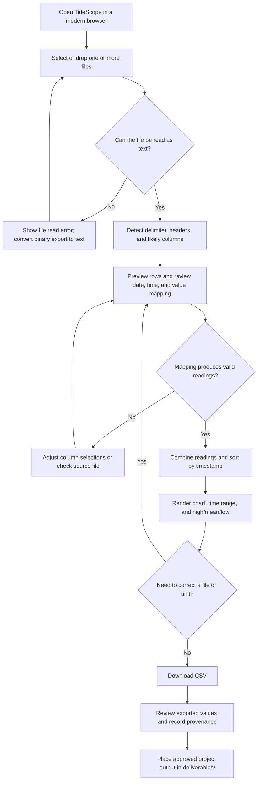

# TideScope workflow

## End-to-end workflow

## Workflow notes

- All parsing and charting occur locally in the browser. The app does not send files to a server.
- Each imported file has its own column mapping. Changing a mapping updates the combined chart.
- Rows without a parseable timestamp or numeric value are omitted from the chart.
- Values are charted as supplied; the unit label does not perform unit conversion.
- Binary or proprietary `.fbf` and `.pos` files must first be converted to readable text. The application cannot infer which ambiguous field represents tide height.
- Review the source file, selected columns, unit, and exported CSV before using results in reports or field decisions.
